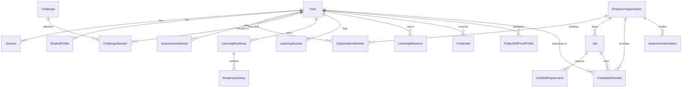

# SkillRoute AI 2.0 — Database Schema Documentation

The platform uses a normalized relational schema managed with Prisma ORM.

## Entity-Relationship Diagram

---

## Detailed Model Specifications

### 1. `User`
- `id`: String (cuid, Primary Key)
- `email`: String (Unique)
- `passwordHash`: String (Bcrypt salt rounds 10)
- `name`: String
- `role`: String (`STUDENT`, `EMPLOYER_OWNER`, `EMPLOYER_RECRUITER`, `ASSESSMENT_REVIEWER`, `PLATFORM_ADMIN`)
- `bio`: String (Optional)
- `isVerified`: Boolean (Default false)
- `createdAt`, `updatedAt`: DateTime

### 2. `StudentProfile`
- `id`: String (cuid, Primary Key)
- `userId`: String (Foreign Key -> User.id, Unique)
- `university`: String (e.g. Daffodil International University)
- `department`: String (e.g. Computer Science and Engineering)
- `graduationYear`: Integer
- `careerGoal`: String (Default: `junior_data_analyst`)
- `weeklyStudyHours`: Integer (Default: 8, bounds: 1-40)
- `skillsJson`: String (JSON Map of skillId -> proficiency 0-5)
- `assessedSkillsJson`: String (JSON Map of skillId -> assessment records)

### 3. `EmployerOrganization`
- `id`: String (Primary Key)
- `name`: String (e.g. TechNext Ltd.)
- `industry`: String
- `size`: String (`1-10`, `11-50`, `51-200`, `201-500`, `500+`)
- `website`: String
- `description`: String
- `isVerified`: Boolean (Default false)

### 4. `Job` & `JobSkillRequirement`
- `Job`: id, organizationId, title, description, careerCategory, location, employmentType, salaryRange, status.
- `JobSkillRequirement`: id, jobId, skillId, targetLevel (1-5), weight (1-3), isRequired.

### 5. `Challenge` & `ChallengeSession`
- `Challenge`: id, title, titleBn, category, careerTrackId, difficulty, estimatedMinutes, scenario, instructions, initialCode, rubricJson, passingScore (Default: 75).
- `ChallengeSession`: id, userId, challengeId, status (`IN_PROGRESS`, `EVALUATED`), mode (`INDEPENDENT`, `AI_ASSISTED`), blurredCount (telemetry), timeSpentSeconds, score, passed, feedback, evalResultsJson.

### 6. `LearningRoadmap` & `RoadmapActivity`
- `LearningRoadmap`: id, userId, careerId, weeklyStudyHours, totalEffortHours, totalWeeks, fourWeekAllocatedHours, remainingHoursBeyondWeek4, weeksJson, isActive.
- `RoadmapActivity`: id, roadmapId, weekNumber, skillId, title, titleBn, hours, completed, completedAt.

### 7. `Credential`
- `id`: String (cuid, Primary Key)
- `credentialId`: String (Unique, e.g. `SKILL-2026-SQL-9831`)
- `userId`: String (Foreign Key -> User.id)
- `skillId`: String
- `competencyTitle`: String
- `assessmentType`: String (`PRACTICALLY_DEMONSTRATED`, `PROJECT_REVIEWED`, `EMPLOYER_VERIFIED`)
- `score`: Float
- `verificationUrl`: String (`/verify/[credentialId]`)
- `status`: String (`ACTIVE`, `REVOKED`)

### 8. `PublicSkillProofProfile`
- `id`: String (cuid, Primary Key)
- `publicId`: String (Unique, cryptographically random slug)
- `userId`: String (Foreign Key -> User.id)
- `targetCareerId`: String
- `consentedFields`: String (JSON array of allowed demographic and competency fields)
- `isPublic`: Boolean
- `revokedAt`: DateTime (Null when active)
- `viewCount`: Integer

### 9. `AuditLog`
- `id`: String (cuid, Primary Key)
- `userId`: String (Foreign Key -> User.id, nullable)
- `action`: String (`USER_LOGIN`, `USER_REGISTER`, `MISSION_SUBMITTED`, `CREDENTIAL_ISSUED`, `PUBLIC_PROFILE_PUBLISHED`, `PUBLIC_PROFILE_REVOKED`, `JOB_POSTED`)
- `resourceType`: String
- `resourceId`: String
- `details`: String
- `ipAddress`: String
- `createdAt`: DateTime
