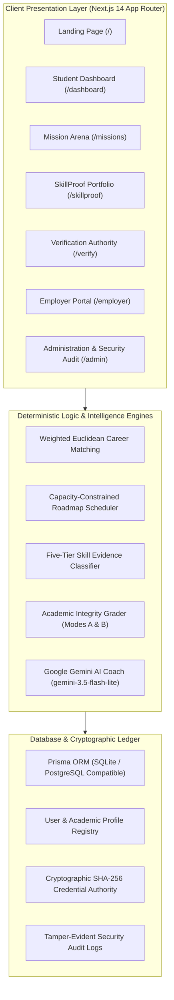

# SkillRoute AI — From Learning to Employability

<p align="center">
  <strong>AI-Assisted Workforce Development, Practical Skill Assessment, Five-Tier Evidence-Based Credentialing & Talent Acquisition Platform</strong>
</p>

<p align="center">
  
  
  
  
  
  
  
  
</p>

---

## 📌 Executive Summary

**SkillRoute AI** is an enterprise-ready, evidence-based workforce readiness and recruitment platform engineered to eliminate the persistent mismatch between university academic output and real-world tech industry expectations. 

Traditional recruitment relies heavily on unvalidated CV buzzwords, inflated self-ratings, and certificates of attendance. SkillRoute AI replaces this friction with an immutable **Five-Tier Skill Evidence Framework**, **in-browser practical engineering challenges (Mission Arena)**, a **deterministic career matching engine**, **contextual Google Gemini AI coaching**, and a **verified Employer Recruitment Portal** featuring instant shortlist confirmation and direct institutional competency endorsements.

---

## 🏛️ System Architecture & Workflow



---

## 🚀 Key Features & Capabilities

### 1. Four-Step Sequential Student Progression Engine (`/dashboard`)
The student experience enforces an academic sequential progression: **Skill Profile → Assessment Hub → Career Matches → 4-Week Roadmap**:

* **Step 1: Technical Skill Profile & Calibration**
  - Interactive competency sliders (Level 0: None to Level 5: Advanced).
  - Catalog skill selector (*Git, REST APIs, HTML/CSS, JavaScript, Linux, Figma, etc.*).
  - Weekly study capacity allocation (2 hrs/wk Casual to 40 hrs/wk Intensive).
  - **Quick Benchmark Calibration Buttons**:
    - `⚡ Benchmark A (SQL 2/5)`: Sets baseline Junior Data Analyst (58.33% match / 80 hrs effort / 10 weeks).
    - `⚡ Benchmark B (SQL 3/5)`: Upgrades SQL to Level 3 (66.67% match / 70 hrs effort / 9 weeks).
  - **Sequential Step Lock & Skill Relock Invariant**: Downstream steps are locked until completed in order. Modifying any skill in Step 1 immediately relocks Steps 2, 3, and 4 until refreshed sequentially.

* **Step 2: Assessment Hub (Diagnostic Checks & Missions)**
  - Standardized diagnostic MCQs evaluating theoretical comprehension.
  - **Demo Fast-Track Tools**: `Fill All Correct Answers (Demo)` and per-question `Fill Correct Answer`.
  - Observational evidence grader classifying results into *Some Supporting Evidence* (Tier 2), *Inconclusive*, or *Claim Not Supported*.
  - Embedded Mission Arena challenges with 1-click full mark (100 pts) demo solver.

* **Step 3: Career Compatibility & Skill Gap Analysis**
  - Evaluates student skills against 5 standardized career tracks:
    1. *Junior Data Analyst*
    2. *Junior Backend Developer*
    3. *Junior Frontend Developer*
    4. *Junior Cybersecurity Analyst*
    5. *Junior UI/UX Designer*
  - Outputs transparent deterministic metrics: **Employability Match %**, **Estimated Effort (hours)**, and **Timeline (weeks)**.
  - Live Skill Gap Breakdown comparing target requirements vs. candidate current levels and evidence tiers.
  - Selecting an active target role dynamically updates the Step 4 Roadmap and DIU Readiness Deck.

* **Step 4: 4-Week Personalized Learning Roadmap & Persistent Tracker**
  - Capacity-constrained allocation (e.g. 8 hrs/wk allocates exactly 32 hours over weeks 1–4, reserving remaining hours).
  - **Interactive Task Checkboxes**: Students check off completed study units with real-time persistent completion tracking.
  - **Study Session Logger**: Logs study minutes, topics, and technical notes to the database.
  - **Google Gemini AI Learning Coach**:
    - Powered by `gemini-3.5-flash-lite` with production API configuration.
    - Generates personalized study strategies, gap remediation advice, and interview preparation tips.
    - **Stale State Detection**: Automatically alerts students to refresh AI guidance whenever profile skills are updated.
    - Persists AI guidance snapshots into the database.

---

### 2. SkillRoute Mission Arena (Practical Task Execution) (`/missions`)
Hands-on technical assessment environments replacing multiple-choice guesswork:
1. **Data Track**: SQL sales performance query optimization with multi-table joins and aggregation.
2. **Backend Track**: REST API endpoint security, payload bounds validation, and error handling.
3. **Security Track**: Simulated Security Operations Center (SOC) brute-force log analysis and incident response.
4. **Frontend Track**: WCAG 2.2 AA accessible component construction with keyboard-navigable ARIA sliders.
5. **UI/UX Track**: Nielsen Norman heuristic usability audit and wireframe contrast evaluation.

* **Academic Integrity Engine**:
  - **Mode A (Independent Coding)**: Candidate works independently. Server-side grading detects undeclared AI markers and applies a 25-point penalty if detected.
  - **Mode B (AI-Assisted with Transparent Disclosure)**: Candidate discloses AI assistance notes. Zero penalty is applied for transparently disclosed AI usage, awarding full 100/100 points for verified correctness.
* Passing scores (≥70%) automatically issue verified Tier 3 credentials (`SR-PRAC-...`).

---

### 3. Five-Tier Skill Evidence Framework

SkillRoute AI maintains strict demarcations across five hierarchical tiers of evidence:

| Tier | Name | Verification Authority | Assessment Method | Student Self-Claim? |
| :--- | :--- | :--- | :--- | :--- |
| **Tier 1** | **Self-Reported** | Student | Self-claimed rating (0–5 scale) | Yes |
| **Tier 2** | **Knowledge Assessed** | SkillRoute AI | Standardized diagnostic MCQs | Yes |
| **Tier 3** | **Practically Demonstrated** | Mission Arena | Practical hands-on coding challenges | Yes |
| **Tier 4** | **Project Reviewed** | SkillRoute AI Rubric | GitHub repository artifact evaluation | Yes (AI Rubric) |
| **Tier 5** | **Employer Verified** | Partner Employers | Recruiter interview or technical trial | **NO (Employer Only)** |

* **Tier 4 (Project Reviewed)**: Students submit Skill Competency, Project Title, and GitHub Repository / Live Artifact URL. SkillRoute AI performs an automated 4-part rubric evaluation (Architecture 25 pts, Implementation 25 pts, Code Quality 25 pts, Testing 25 pts), issuing `SR-PRJ-...` credentials and unlocking the **SkillProof™ Level 4 Portfolio**.
* **Tier 5 (Employer Verified)**: **Cannot be self-awarded by students**. Non-employer attempts are blocked with HTTP 403 Forbidden. Tier 5 is exclusively awarded by authorized recruiters in the Employer Portal during candidate interviews or recruitment evaluations (`SR-EMP-...`), unlocking the **SkillProof™ Level 5 Portfolio**.

---

### 4. SkillProof™ Evidence Portfolio & Credential Verification (`/skillproof` & `/verify`)

* **Dynamic Portfolio Badges**: Automatically updates candidate portfolio rank from Level 1 up to Level 5 based on verified credentials.
* **Candidate Competencies Matrix**: Live badges mapping each skill to its highest proven tier.
* **Tamper-Resistant Cryptographic Credentials**: Public verification records (`/verify/[credentialId]`) with real-time scannable QR codes, SHA-256 hashes, and institutional authority disclaimers.
* **Granular Privacy & Public Portfolio Sharing**:
  - Checkbox consent controls (*name, university, career goal, verified skills, assessment results*).
  - 1-Click **Publish Portfolio** creates a public recruiter link (`/portfolio/[publicId]`).
  - 1-Click **Revoke Portfolio** instantly withdraws public visibility.
* **Export & Print**: One-click standardized JSON export and print-formatted PDF institutional dossier.

---

### 5. Employer Recruitment Portal (`/employer`)

Empowers partner employers (*e.g., TechNext Ltd., Brain Station 23, DIU Innovation Lab*) to hire verified talent:

* **Tab 1: Candidate Discovery & Competency Search**
  - Filter candidates by career track and verified competency thresholds.
  - **Instant Shortlist Feedback**: Clicking `+ Shortlist Candidate` displays an immediate emerald toast notification (`✓ Candidate [Name] successfully shortlisted and added to your recruitment pipeline!`) and updates the button to `✓ Shortlisted`.
  - **Candidate Evidence Dossier Modal ("Make Their Detail")**:
    - Candidate Name, University (*DIU*), Department (*CSE*), Graduation Year (*2026*), Active Education Status, and Contact Email.
    - Employability match fit score and target role.
    - Five-Tier Demonstrated Skill Matrix with live badges.
    - Verified credentials list with direct verification links.
    - **`⚡ Endorse Candidate (Award Tier 5 Badge)`**: Recruiter selects a skill and awards direct institutional endorsement (`SR-EMP-...`) live into the database!
* **Tab 2: Job Openings Management**
  - Post new jobs with minimum competency thresholds (*e.g., SQL ≥ Level 3, Python ≥ Level 3*).
* **Tab 3: Recruitment Pipeline**
  - Manage candidate pipeline across 4 stages: `REVIEWING` → `SHORTLISTED` → `INTERVIEWING` → `OFFERED`.

---

### 6. Platform Administration & Security Governance (`/admin`)

* **Platform Metrics**: Real-time counters for Total Users, Active Students, Registered Organizations, Credentials Issued, and Practical Missions Evaluated.
* **User Directory**: Role management across `STUDENT`, `EMPLOYER_OWNER`, `EMPLOYER_RECRUITER`, and `ADMIN`.
* **Organization Governance**: Verification badge management for partner employers.
* **Tamper-Evident Audit Ledger**: Immutable audit log recording all logins, job creations, candidate shortlisting, credential issuances, and profile changes with IP tracking.

---

### 7. Modern UI Design System & 100% Bilingual Localization

* **Widescreen Balanced Layout**: Designed for modern displays (`max-w-[1720px]`) with zero empty margins.
* **Theme System**: Seamless Dark and Light mode honoring system preference or user toggle.
* **100% English & Bengali Key Parity**: 239/239 keys strictly synchronized with native Bengali numerals (`২০২৬`, `৫৮.৩৩%`, `৮০`).

---

## 📐 Mathematical Invariants & Benchmark Proofs

The platform enforces transparent, reproducible mathematical formulas:

$$\text{Match Percentage} = \max\left(0, \min\left(100, 100 \times \left(1 - \frac{\sqrt{\sum w_i (\text{target}_i - \min(\text{current}_i, \text{target}_i))^2}}{\sqrt{\sum w_i \cdot \text{target}_i^2}}\right)\right)\right)$$

$$\text{Estimated Effort Hours} = \sum \max(0, \text{target}_i - \text{current}_i) \times \text{hours\_per\_level}_i$$

$$\text{Estimated Weeks} = \lceil \text{Estimated Effort Hours} / \text{Weekly Study Hours} \rceil$$

### Automated Test Runner Results (`scripts/run-tests.ts`):
```
==================================================================
 SkillRoute AI - Verification of Mathematical Invariants
==================================================================
Test Group 1: Benchmark A — Junior Data Analyst (58.33% / 80h / 10w) -> ALL PASS
Test Group 2: Benchmark B — Updated SQL Level 3 (66.67% / 70h / 9w)  -> ALL PASS
Test Group 3: Monotonicity & Clamping Invariants                     -> ALL PASS
Test Group 4: Skill Aliases & Canonical Normalization               -> ALL PASS
Test Group 5: Diagnostic Assessment Observational Evidence           -> ALL PASS
Test Group 6: Mission Arena Server-Side Assessment Graders           -> ALL PASS
Test Group 7: Bengali Numerals & 100% Translation Key Parity         -> ALL PASS
Test Group 8: Academic Integrity & Transparent AI Disclosure Engine  -> ALL PASS
Test Group 9: Starter Code vs Full Mark Solution Verification        -> ALL PASS
Test Group 10: Five-Tier Skill Evidence Framework Resolver           -> ALL PASS
==================================================================
 Test Summary: 50 PASSED, 0 FAILED
==================================================================
```

---

## 🛠️ Technology Stack

| Domain | Technologies |
| :--- | :--- |
| **Frontend** | Next.js 14 (App Router), React 18, Tailwind CSS, Lucide React, QRCode |
| **Backend** | Next.js Server Components, API Route Handlers, Zod Validation |
| **Database & ORM** | Prisma ORM with SQLite (`dev.db`), PostgreSQL production-ready |
| **AI Integration** | Google Gemini API (`@google/genai`) using `gemini-3.5-flash-lite` |
| **Authentication** | Bcrypt password hashing, session cookies, Role-Based Access Control (RBAC) |
| **Testing** | Node.js TSX test runner (`scripts/run-tests.ts`), Browser Subagents |

---

## 💻 Local Installation & Setup Guide

### Prerequisites
- **Node.js**: Version `18.x` or `20.x` LTS ([Download Node.js](https://nodejs.org/))
- **npm**: Bundled with Node.js
- **Web Browser**: Chrome, Edge, Brave, or Firefox

### Step-by-Step Commands

```powershell
# 1. Clone the repository
git clone https://github.com/void-pronway/SkillRoute_AI-AIBC2026.git
cd SkillRoute_AI-AIBC2026

# 2. Install dependencies
npm install

# 3. Setup environment variables (create .env from .env.example)
cp .env.example .env

# 4. Push database schema & generate Prisma Client
npx prisma db push
npx prisma generate

# 5. Seed database with demo accounts, benchmarks, and challenges
node scripts/seed.js

# 6. Run automated tests (50/50 test assertions)
npm test

# 7. Start the application
# For Development Mode:
npm run dev

# OR for Production Optimized Mode:
npm run build
npm start
```

Open your browser and navigate to: **`http://localhost:3000`**

---

## 👤 1-Click Demo Accounts

Use the **1-Click Demo** buttons on the [Login Page](http://localhost:3000/login) or enter credentials directly:

| Persona | Email | Password | Primary Workflow |
| :--- | :--- | :--- | :--- |
| **Student** | `student@skillroute.ai` | `password123` | Benchmarks A & B, 4-Step Flow, Mission Arena, SkillProof |
| **Employer** | `employer@technext.bd` | `password123` | Talent Search, Shortlist Toast, Candidate Dossier, Tier 5 Endorse |
| **Admin** | `admin@skillroute.ai` | `password123` | Metric Counters, User Governance, Org Seals, Security Audit Logs |

---

## 📂 Project Structure

```
├── prisma/
│   └── schema.prisma            # Prisma ORM relational schema & credential models
├── scripts/
│   ├── run-tests.ts             # 50-assertion mathematical invariant & parity test suite
│   └── seed.js                  # Database seeder with DIU personas & challenge seeds
├── src/
│   ├── app/
│   │   ├── admin/page.tsx       # Platform Administration & Security Audit Portal
│   │   ├── api/                 # Next.js Route Handlers (Auth, AI, Credentials, Employer)
│   │   ├── dashboard/page.tsx   # 4-Step Student Dashboard & Gemini AI Coach
│   │   ├── employer/page.tsx    # Employer Recruitment Portal & Candidate Dossier
│   │   ├── missions/            # Practical Mission Arena Catalog & Coding Workspace
│   │   ├── portfolio/           # Public Sharable Evidence Portfolio View
│   │   ├── skillproof/page.tsx  # Five-Tier SkillProof Portfolio & Tier 4 Review Hub
│   │   └── verify/              # Cryptographic Credential Verification Authority
│   ├── components/              # Reusable UI components (Navbar, Footer, EvidenceBadges)
│   ├── context/AppContext.tsx   # Global state, theme toggle, and i18n context
│   ├── data/                    # Careers, diagnostic questions, and challenge datasets
│   ├── lib/                     # Auth helpers, Prisma client, and 100% bilingual dictionaries
│   └── logic/                   # Deterministic matching, roadmaps, and rubric evaluators
├── .env.example                 # Template environment variables
├── .gitignore                   # Production gitignore (protects secrets & SQLite db)
├── package.json                 # Project dependencies & scripts
└── tailwind.config.ts           # Custom brand color palette & styling tokens
```

---

## 🏆 Institutional Verification

Developed for the **AIBC Workforce Ready Challenge 2026** at **Daffodil International University (DIU)**.  
*All mathematical benchmarks, academic integrity evaluations, and credential verification procedures are fully auditable and deterministic.*
