# SkillRoute AI — From Learning to Employability

<p align="center">
  <strong>AI-Assisted Workforce Development, Practical Skill Assessment, Five-Tier Evidence-Based Credentialing & Talent Acquisition Platform</strong>
</p>

<p align="center">
  
  
  
  
  
  
  
  
</p>

---

## 📌 Executive Summary

**SkillRoute AI** is an enterprise-grade, evidence-based workforce readiness and recruitment platform engineered to eliminate the persistent disconnect between university academic curricula and real-world tech industry expectations.

Traditional hiring pipelines rely on unverified CV keywords, self-inflated ratings, and non-verifiable participation certificates. SkillRoute AI disrupts this paradigm with:
1. **Five-Tier Skill Evidence Framework**: Clear institutional demarcation separating self-claims, diagnostic knowledge, practical mission executions, automated project rubric reviews, and recruiter endorsements.
2. **Four-Step Sequential Student Progression**: Deterministic skill calibration, observational diagnostic assessments, weighted Euclidean career matching, and capacity-constrained 4-week roadmap scheduling.
3. **SkillRoute Mission Arena**: Practical in-browser coding environments with server-side AST analysis and Academic Integrity Graders (Modes A & B).
4. **Contextual Google Gemini AI Coach**: Production-integrated `gemini-3.5-flash-lite` analyzing individual skill gaps and generating persistent study strategies with stale-state detection.
5. **Verified Employer Portal & Candidate Dossier**: Instant shortlist pipeline notifications, comprehensive candidate evidence dossiers, and direct institutional Tier 5 competency endorsements.
6. **Cryptographic Verification Authority**: Tamper-resistant credential records with SHA-256 verification hashes and scannable QR codes.

---

## 👤 1-Click Demo Accounts

The platform includes four pre-seeded demo personas configured with real DIU academic profiles, baseline skill records, and historical credentials. You can click any of the **Quick Demo Login** buttons on the [Login Page](http://localhost:3000/login) or enter credentials manually:

| Persona | Email | Password | Role & Track Focus | Key Demonstration Workflows |
| :--- | :--- | :--- | :--- | :--- |
| **Student 1** | `student@skillroute.ai` | `password123` | **Data Analyst Track**<br>*(Name: Pronway Prosoon Mitra)* | • Benchmarks A & B calibration<br>• 4-Step sequential progression & Step Lock<br>• Assessment Hub with 1-Click correct answers<br>• Mission Arena coding & 1-Click full score<br>• SkillProof™ Level 4 & Level 5 badges |
| **Student 2** | `student1@skillroute.ai` | `Test123` | **Junior Backend Track**<br>*(Name: Mashfiqur Rahman)* | • Pre-configured DIU CSE undergraduate profile<br>• Python, SQL, REST APIs & JavaScript skills<br>• Step 3 Career Gap evaluation for Backend roles<br>• Step 4 Capacity-constrained learning roadmap<br>• Live Gemini AI coaching guidance generation |
| **Employer** | `employer@technext.bd` | `password123` | **TechNext Ltd. Recruiter**<br>*(Org Owner)* | • Candidate discovery with skill threshold filters<br>• **Instant Shortlist Toast Notification**<br>• **Candidate Evidence Dossier ("Make Their Detail")**<br>• **1-Click Tier 5 Institutional Endorsement** |
| **Admin** | `admin@skillroute.ai` | `password123` | **System Administrator**<br>*(Governance & Compliance)* | • Platform health metrics & aggregate analytics<br>• User directory & role governance<br>• Partner organization verified badge management<br>• Tamper-evident immutable security audit ledger |

---

## 📸 Visual UI & Feature Walkthrough Gallery

This interactive visual gallery illustrates the core workflows of **SkillRoute AI**.  
👉 **Click on any image to open the full-resolution screenshot in a new tab.**

<table>
  <tr>
    <td width="50%" valign="top" align="center">
      <a href="docs/screenshots/01_landing_page.png">
        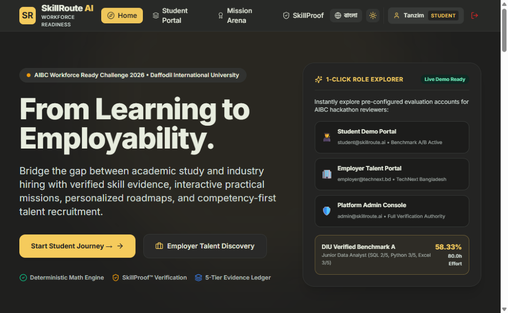
      </a>
      <br />
      <strong>1. Landing Page (Modern Design System)</strong>
      <br />
      <sub>Dark/Light mode, bilingual toggle, full widescreen layout with 1-click test accounts.</sub>
    </td>
    <td width="50%" valign="top" align="center">
      <a href="docs/screenshots/02_student_step1_skills.png">
        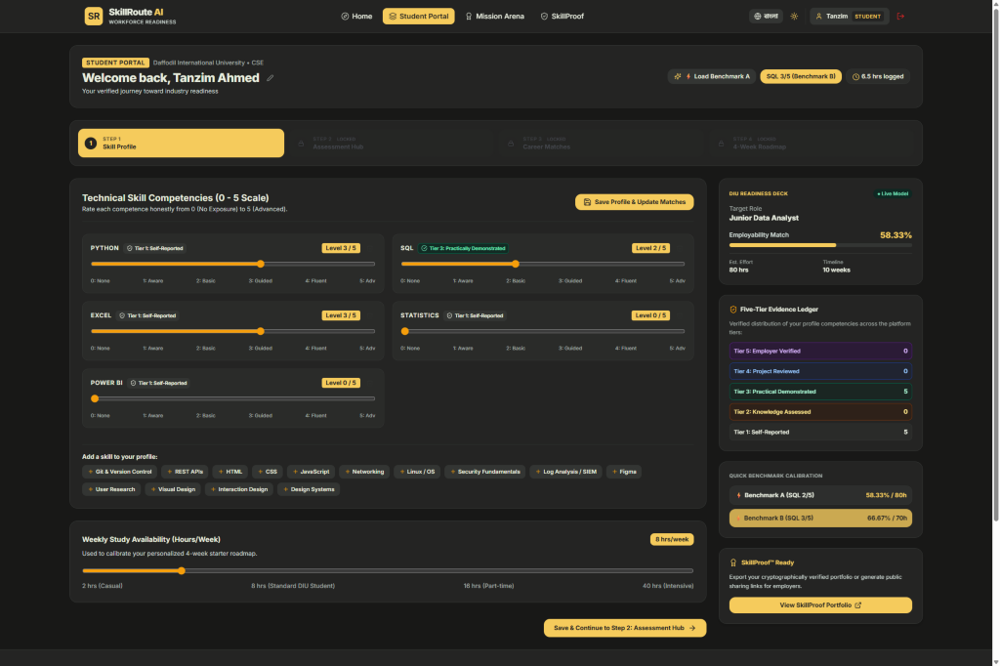
      </a>
      <br />
      <strong>2. Step 1: Skill Profile Calibration & Step Lock</strong>
      <br />
      <sub>Competency sliders (0–5), study capacity allocation, and strict sequential step enforcement.</sub>
    </td>
  </tr>
  <tr>
    <td width="50%" valign="top" align="center">
      <a href="docs/screenshots/03_student_step2_assessment.png">
        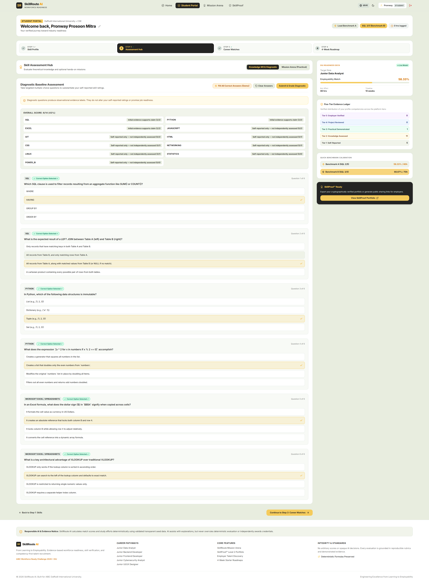
      </a>
      <br />
      <strong>3. Step 2: Assessment Hub (1-Click Solvers)</strong>
      <br />
      <sub>Standardized diagnostic MCQs with demo autofill tools and live observational evidence grading.</sub>
    </td>
    <td width="50%" valign="top" align="center">
      <a href="docs/screenshots/04_student_step3_career_matches.png">
        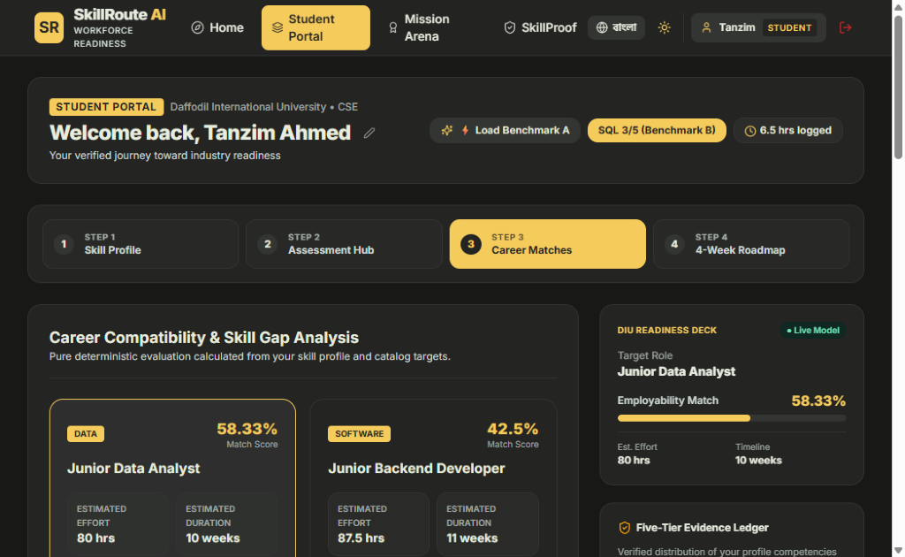
      </a>
      <br />
      <strong>4. Step 3: Career Compatibility & Gap Analysis</strong>
      <br />
      <sub>Deterministic Euclidean matching, match %, effort hours, timeline, and dynamic role selection.</sub>
    </td>
  </tr>
  <tr>
    <td width="50%" valign="top" align="center">
      <a href="docs/screenshots/05_student_step4_roadmap_tracker.png">
        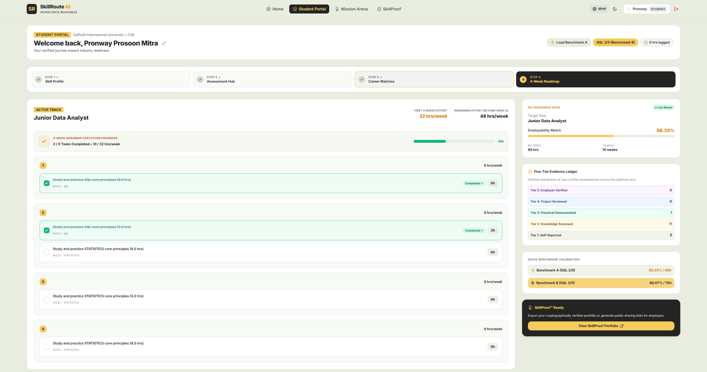
      </a>
      <br />
      <strong>5. Step 4: 4-Week Roadmap & Persistent Tracker</strong>
      <br />
      <sub>Capacity-constrained study milestones, interactive task checkoffs, and study session logger.</sub>
    </td>
    <td width="50%" valign="top" align="center">
      <a href="docs/screenshots/06_student_step4_gemini_ai_coach.png">
        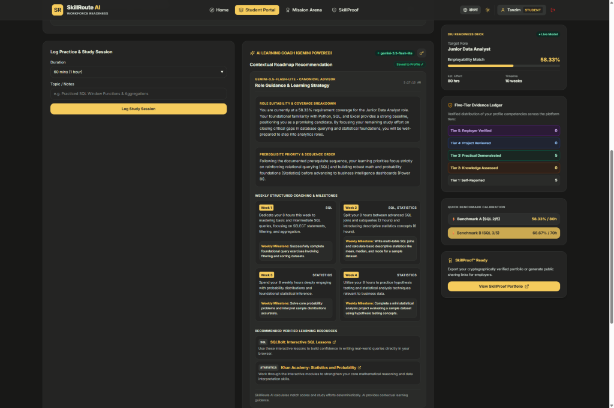
      </a>
      <br />
      <strong>6. Step 4: Google Gemini AI Learning Coach</strong>
      <br />
      <sub>Contextual AI coaching via gemini-3.5-flash-lite, gap remediation, and stale-state alert.</sub>
    </td>
  </tr>
  <tr>
    <td width="50%" valign="top" align="center">
      <a href="docs/screenshots/07_mission_arena_evaluator.png">
        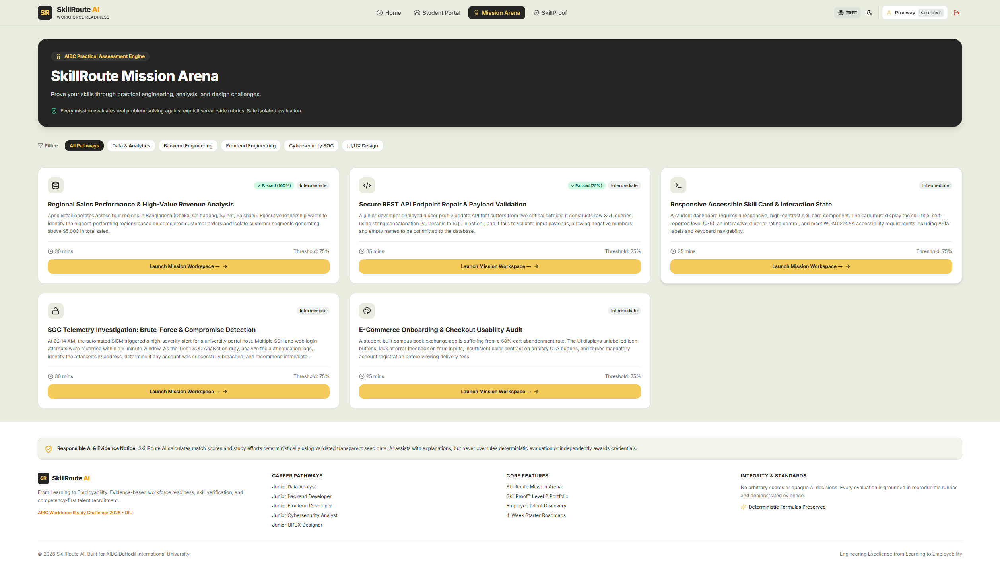
      </a>
      <br />
      <strong>7. Mission Arena (Practical Coding Workspace)</strong>
      <br />
      <sub>In-browser coding challenge with test runner, Mode A/B integrity grading, and 1-click solver.</sub>
    </td>
    <td width="50%" valign="top" align="center">
      <a href="docs/screenshots/08_skillproof_five_tier_portfolio.png">
        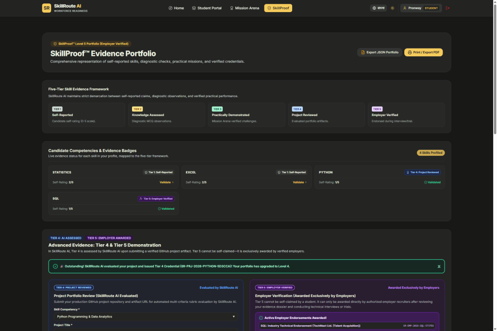
      </a>
      <br />
      <strong>8. SkillProof™ Evidence Portfolio & Badges</strong>
      <br />
      <sub>5-Tier competency badges, Tier 4 AI rubric project review, and Tier 5 employer authorization.</sub>
    </td>
  </tr>
  <tr>
    <td width="50%" valign="top" align="center">
      <a href="docs/screenshots/09_credential_qr_verification.png">
        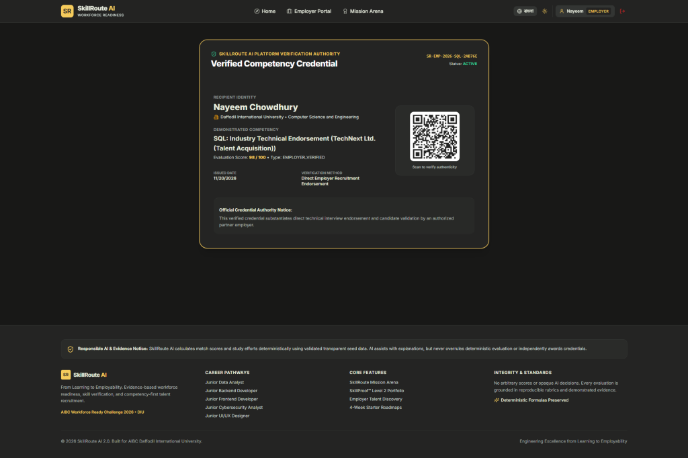
      </a>
      <br />
      <strong>9. Cryptographic Credential QR Verification</strong>
      <br />
      <sub>Publicly verifiable credential certificate with SHA-256 hash, dynamic QR code, and issuer seal.</sub>
    </td>
    <td width="50%" valign="top" align="center">
      <a href="docs/screenshots/10_employer_candidate_shortlist.png">
        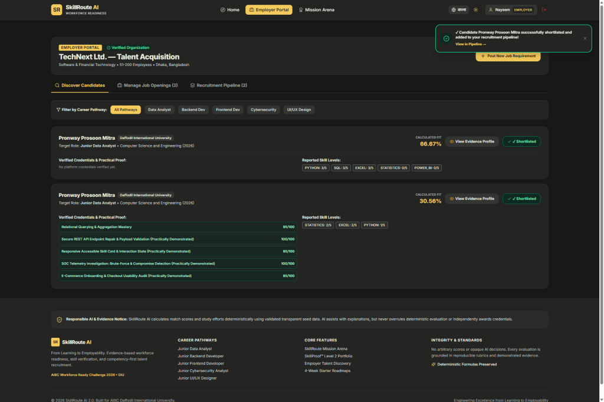
      </a>
      <br />
      <strong>10. Employer Discovery & Shortlist Feedback Toast</strong>
      <br />
      <sub>Multi-filter candidate discovery, verified skill pills, and instant emerald shortlist notification.</sub>
    </td>
  </tr>
  <tr>
    <td width="100%" valign="top" align="center" colspan="2">
      <a href="docs/screenshots/11_employer_candidate_dossier_tier5.png">
        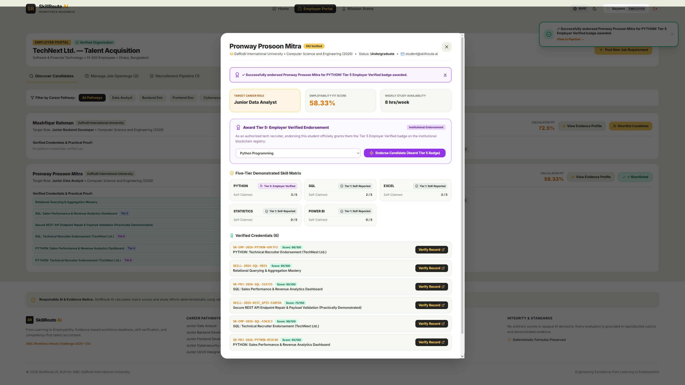
      </a>
      <br />
      <strong>11. Candidate Evidence Dossier Modal & Tier 5 Institutional Endorsement</strong>
      <br />
      <sub>Deep candidate profile inspection and 1-click live institutional Tier 5 endorsement awarding.</sub>
    </td>
  </tr>
</table>

> 💡 **Customizing Screenshots:** To replace any screenshot with your own custom capture, save your image into [`docs/screenshots/`](docs/screenshots/) using the corresponding filename (e.g. `01_landing_page.png`). See [docs/screenshots/README.md](docs/screenshots/README.md) for details.

---

## 🏛️ System Architecture

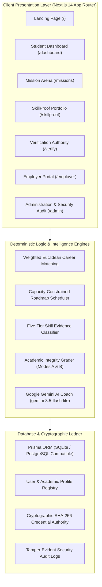

---

## 🏆 Five-Tier Skill Evidence Framework

SkillRoute AI enforces strict institutional boundaries across five tiers of competency proof:

| Tier | Tier Level Name | Verification Authority | Assessment Method | Student Self-Award Allowed? |
| :---: | :--- | :--- | :--- | :---: |
| **Tier 1** | **Self-Reported** | Student | Self-claimed rating slider (0–5 scale) | **Yes** |
| **Tier 2** | **Knowledge Assessed** | SkillRoute AI | Standardized diagnostic MCQs | **Yes** |
| **Tier 3** | **Practically Demonstrated** | Mission Arena | Practical hands-on coding challenges | **Yes** |
| **Tier 4** | **Project Reviewed** | SkillRoute AI Rubric | GitHub repository & artifact rubric review | **Yes (via Rubric)** |
| **Tier 5** | **Employer Verified** | Partner Employers | Recruiter interview or technical trial | **STRICTLY NO (Employer Only)** |

* **Tier 4 (Project Reviewed)**: Students submit Skill Competency, Project Title, and GitHub Repository / Artifact URL. SkillRoute AI evaluates the submission against a 4-part rubric (Architecture 25 pts, Implementation 25 pts, Code Quality 25 pts, Testing 25 pts), awarding `SR-PRJ-...` credentials and unlocking the **SkillProof™ Level 4 Portfolio**.
* **Tier 5 (Employer Verified)**: **Cannot be self-awarded by students**. Non-employer attempts are blocked with HTTP 403 Forbidden. Tier 5 is exclusively awarded by authorized recruiters in the Employer Portal during candidate interviews or recruitment evaluations (`SR-EMP-...`), unlocking the **SkillProof™ Level 5 Portfolio**.

---

## 📐 Mathematical Invariants & Verification Proofs

The platform enforces reproducible mathematical formulas:

$$\text{Match Percentage} = \max\left(0, \min\left(100, 100 \times \left(1 - \frac{\sqrt{\sum w_i (\text{target}_i - \min(\text{current}_i, \text{target}_i))^2}}{\sqrt{\sum w_i \cdot \text{target}_i^2}}\right)\right)\right)$$

$$\text{Estimated Effort Hours} = \sum \max(0, \text{target}_i - \text{current}_i) \times \text{hours\_per\_level}_i$$

$$\text{Estimated Weeks} = \lceil \text{Estimated Effort Hours} / \text{Weekly Study Hours} \rceil$$

### Automated Test Suite Execution (`scripts/run-tests.ts`):
```
==================================================================
 SkillRoute AI - Verification of Mathematical Invariants
==================================================================
Test Group 1: Benchmark A — Junior Data Analyst (58.33% / 80h / 10w) -> ALL PASS
Test Group 2: Benchmark B — Updated SQL Level 3 (66.67% / 70h / 9w)  -> ALL PASS
Test Group 3: Monotonicity & Clamping Invariants                     -> ALL PASS
Test Group 4: Skill Aliases & Canonical Normalization               -> ALL PASS
Test Group 5: Diagnostic Assessment Observational Evidence           -> ALL PASS
Test Group 6: Mission Arena Server-Side Assessment Graders           -> ALL PASS
Test Group 7: Bengali Numerals & 100% Translation Key Parity         -> ALL PASS
Test Group 8: Academic Integrity & Transparent AI Disclosure Engine  -> ALL PASS
Test Group 9: Starter Code vs Full Mark Solution Verification        -> ALL PASS
Test Group 10: Five-Tier Skill Evidence Framework Resolver           -> ALL PASS
==================================================================
 Test Summary: 50 PASSED, 0 FAILED
==================================================================
```

---

## 🛠️ Technology Stack

| Domain | Technologies |
| :--- | :--- |
| **Frontend Framework** | Next.js 14.2 (App Router with Server & Client Components) |
| **Language & Typing** | TypeScript 5.6 with strict type-safety |
| **Styling & Design System** | Tailwind CSS 3.4, Lucide React icons, Custom Color Tokens |
| **Database & ORM** | Prisma ORM 5.22 with SQLite (`dev.db`), PostgreSQL production-ready |
| **Artificial Intelligence** | Google Gemini API (`@google/genai`) with `gemini-3.5-flash-lite` |
| **Security & Auth** | Bcrypt password encryption, session cookies, Role-Based Access Control (RBAC) |
| **Verification & Hashes** | Node.js Crypto (SHA-256 signatures), QRCode generation |
| **Quality Assurance** | Automated TSX Test Runner (`scripts/run-tests.ts`), Subagent Browser QA |

---

## 💻 Local Installation & Setup Guide

### System Prerequisites
- **Node.js**: Version `18.x` or `20.x` LTS ([Download Node.js](https://nodejs.org/))
- **npm**: Version `9.x` or higher (bundled with Node.js)
- **Web Browser**: Google Chrome, Microsoft Edge, Brave, or Firefox

### Step-by-Step Installation Commands

```powershell
# 1. Clone the repository
git clone https://github.com/void-pronway/SkillRoute_AI-AIBC2026.git
cd SkillRoute_AI-AIBC2026

# 2. Install all dependencies
npm install

# 3. Setup environment variables (create .env from .env.example)
cp .env.example .env

# 4. Push database schema & generate Prisma Client
npx prisma db push
npx prisma generate

# 5. Seed database with demo accounts, benchmarks, and challenges
node scripts/seed.js

# 6. Run automated test suite (50/50 test assertions)
npm test

# 7. Start the application
# For Development Mode:
npm run dev

# OR for Production Optimized Mode:
npm run build
npm start
```

Open your browser and navigate to: **`http://localhost:3000`**

---

## 🚀 Free Cloud Deployment on Render

SkillRoute AI is pre-configured with a native Render Blueprint (`render.yaml`) for 100% free cloud deployment:

### Option A: 1-Click Blueprint (Recommended)
1. Push this repository to your GitHub account.
2. Log into [Render.com](https://render.com/).
3. Click **New +** → **Blueprint**.
4. Select your repository `SkillRoute_AI-AIBC2026`.
5. Render reads `render.yaml` automatically and configures:
   - **Environment:** Node.js
   - **Plan:** Free
   - **Region:** Singapore (`singapore`)
   - **Build Command:** `npm install --include=dev && npx prisma db push && node scripts/seed.js && npm run build`
   - **Start Command:** `npx prisma db push && node scripts/seed.js && npm start`
6. Click **Apply**. Within 3–4 minutes, your live URL (`https://skillroute-ai.onrender.com`) will be running with all demo accounts pre-seeded!

### Option B: Manual Web Service Setup
If creating manually without Blueprint:
1. On Render Dashboard, click **New +** → **Web Service**.
2. Connect your GitHub repository.
3. Configure the settings:
   - **Name:** `skillroute-ai`
   - **Runtime:** `Node`
   - **Build Command:** `npm install --include=dev && npx prisma db push && node scripts/seed.js && npm run build`
   - **Start Command:** `npx prisma db push && node scripts/seed.js && npm start`
   - **Plan:** `Free`
4. Under **Environment Variables**, add:
   - `DATABASE_URL`: `file:./dev.db`
   - `SESSION_SECRET`: `change-to-any-random-32-character-secret`
   - `NODE_ENV`: `production`
   - `GEMINI_API_KEY`: *(Optional Google Gemini API key)*
5. Click **Create Web Service**.

---

## 📂 Project Directory Structure

```
├── docs/
│   └── screenshots/             # UI Walkthrough screenshots and image placeholders
│       ├── 01_landing_page.png
│       ├── 02_student_step1_skills.png
│       ├── 03_student_step2_assessment.png
│       ├── 04_student_step3_career_matches.png
│       ├── 05_student_step4_roadmap_tracker.png
│       ├── 06_student_step4_gemini_ai_coach.png
│       ├── 07_mission_arena_evaluator.png
│       ├── 08_skillproof_five_tier_portfolio.png
│       ├── 09_credential_qr_verification.png
│       ├── 10_employer_candidate_shortlist.png
│       └── 11_employer_candidate_dossier_tier5.png
├── prisma/
│   └── schema.prisma            # Relational models (Users, Profiles, Credentials, AuditLogs)
├── scripts/
│   ├── run-tests.ts             # 50-assertion mathematical invariant & parity test suite
│   └── seed.js                  # Database seeder (Student 1, Student 2, Employer, Admin)
├── src/
│   ├── app/
│   │   ├── admin/page.tsx       # Platform Administration & Security Audit Portal
│   │   ├── api/                 # Next.js Route Handlers (Auth, AI, Credentials, Employer)
│   │   ├── dashboard/page.tsx   # 4-Step Student Dashboard & Gemini AI Coach
│   │   ├── employer/page.tsx    # Employer Recruitment Portal & Candidate Dossier
│   │   ├── login/page.tsx       # Authentication & 4-Button 1-Click Demo Login
│   │   ├── missions/            # Practical Mission Arena Catalog & Coding Workspace
│   │   ├── portfolio/           # Public Sharable Evidence Portfolio View
│   │   ├── skillproof/page.tsx  # Five-Tier SkillProof Portfolio & Tier 4 Review Hub
│   │   └── verify/              # Cryptographic Credential Verification Authority
│   ├── components/              # Navbar, Footer, EvidenceBadges, Modal Dialogs
│   ├── context/AppContext.tsx   # Global state, theme toggle, and i18n context
│   ├── data/                    # Careers, diagnostic questions, and challenge datasets
│   ├── lib/                     # Auth helpers, Prisma client, and 100% bilingual dictionaries
│   └── logic/                   # Deterministic matching, roadmaps, and rubric evaluators
├── .env.example                 # Template environment variables
├── .gitignore                   # Production gitignore (protects secrets & SQLite db)
├── package.json                 # Project dependencies & scripts
└── tailwind.config.ts           # Custom brand color palette & styling tokens
```

---

## 🏆 Institutional Verification & Credits

Developed for the **AIBC Workforce Ready Challenge 2026** at **Daffodil International University (DIU)**.  
*All mathematical benchmarks, academic integrity evaluations, and credential verification procedures are fully auditable and deterministic.*
